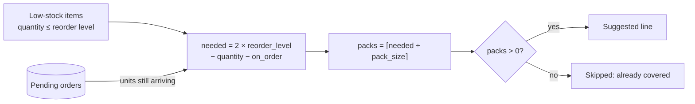

# Restaurant Operations & Supply Chain API


A backend for running a fast-food restaurant: staff scheduling, stock control and supplier
ordering. It is built around the rules a real restaurant in Germany has to follow, including
fixed supplier delivery days, whole-box ordering, the **Arbeitszeitgesetz** and the
**Europe/Berlin** clock with its DST changes.

> Each feature started as an operational problem: stock counts that go negative, orders that
> must arrive in 15 kg boxes, a night shift that spans the switch to winter time.
> The README covers what was built and the reasoning behind it.

---

## Contents

- [Project highlights](#project-highlights)
- [Engineering problems solved](#engineering-problems-solved)
  - [1. Smart restock & supply chain](#1-smart-restock--supply-chain)
  - [2. German labor law compliance (Arbeitszeitgesetz)](#2-german-labor-law-compliance-arbeitszeitgesetz)
  - [3. Realistic inventory management](#3-realistic-inventory-management)
  - [4. Automated receiving & complaints (Reklamation)](#4-automated-receiving--complaints-reklamation)
- [Engineering quality](#engineering-quality)
- [Tech stack](#tech-stack)
- [Architecture](#architecture)
- [API overview](#api-overview)
- [How to run](#how-to-run)
- [Frontend](#frontend)
- [Testing](#testing)

---

## Project highlights

| Business problem | What the API does | Value |
| --- | --- | --- |
| Managers spend time each day working out what to order | **One-call order draft**: every low-stock item, rounded up to whole supplier packs, minus what's already on its way | Fewer stock-outs and no double-ordering |
| Suppliers only deliver on certain days, with a cut-off | Every order gets its **expected delivery date** (Tue / Thu / Sat, 14:00 cut-off the day before) | Staff know when goods will arrive |
| Scheduling mistakes break labor law | **Shifts over 10 hours and double-booked staff are rejected** | Compliance is enforced on every create and update |
| Stock records don't match the shelves | **Negative stock is allowed**, and physical counts correct it while logging the variance | The system reflects reality, and shrinkage shows up |
| Nobody should have to book in every delivery by hand | **Deliveries are received automatically at 06:00** on their delivery day, with catch-up after downtime | Stock is right before the morning shift starts |
| Deliveries arrive short, damaged or with extras | **Complaints (Reklamation)** per order line, applied to stock only when a manager approves | Corrections leave an audit trail instead of silent edits |
| Counting everything every day isn't practical | **Daily Key-Item audits** plus **weekly and end-of-month full audits** | Fast checks on the important items, full accuracy each week and month |
| Stock leaves without a sale: waste, or lending to a nearby branch | **Waste log** and **store transfers** that update stock as they're recorded | Every movement is explained, so the count variance shrinks |
| A dropped Whopper is a patty and a bun, not a line in the menu | **Bill of materials**: wasted burgers are broken down into their ingredients, each logged with a note like "(From wasted Whopper)" | Waste lands on the stock that was actually lost |
| An area manager needs the picture at a glance | **Dashboard summary**: stock health, today's waste, recent transfers, open deliveries and complaints | One screen instead of five |

---

## Engineering problems solved

### 1. Smart restock & supply chain

**Problem:** Suppliers don't sell 64.5 kg of fries. They sell 15 kg boxes. Orders that are
already on their way shouldn't be ordered again. And an order placed Monday afternoon will not
make Tuesday's delivery.

**Solution:** `POST /purchase-orders/auto-suggest` builds a draft order for review. It saves
nothing until a manager submits it.



**Worked example:** French Fries are at **−4.5 kg** (more sold than recorded), the reorder level is
30 kg and fries come in **15 kg boxes**.

```text
needed = 2 × 30 − (−4.5) − 0 = 64.5 kg
packs  = ⌈64.5 ÷ 15⌉       = 5 boxes  →  75 kg delivered
```

```json
{ "item_id": 8, "packs": 5, "name": "French Fries", "unit": "kg",
  "pack_size": 15, "quantity": 75, "needed": 64.5,
  "current_quantity": -4.5, "reorder_level": 30, "on_order": 0 }
```

Details that make it work in practice:

- **Orders are in whole packs** (`packs: int`). Stock, reorder levels and audits stay in the
  item's own unit (kg, L, pcs).
- **Each order line saves the item's pack size at the time of ordering.** If the supplier
  changes box sizes later, open orders still add the right amount to stock.
- **Float-safe rounding.** `0.3 ÷ 0.1` is `2.9999…` in floating point, so the division is
  rounded before taking the ceiling. Noise can't add or drop a whole box.
- **Delivery days.** Orders arrive Tuesday, Thursday or Saturday, and must be placed before
  14:00 Berlin time the day before. Monday 13:59 arrives Tuesday; Monday 14:00 arrives
  Thursday.
- **Deliveries are received automatically.** See
  [Automated receiving](#4-automated-receiving--complaints-reklamation).

### 2. German labor law compliance (Arbeitszeitgesetz)

**Problem:** § 3 ArbZG limits working time to 10 hours a day. A staff member also can't work
two shifts at once. And one night a year, the clock goes from 03:00 back to 02:00.

**Solution:** these rules are checked on **every create and every update**, including when
a shift is reassigned to another employee:

| Rule | Response |
| --- | --- |
| `end_time` must be strictly after `start_time` | `422` |
| A shift may last **at most 10 hours** of real elapsed time | `422` |
| No overlap with another shift of the same employee | `400`, naming the clashing shift |
| Back-to-back shifts (one ends exactly when the next starts) | allowed |

**Subtle bug avoided:** Python subtracts two aware datetimes that share a `tzinfo` by **wall
clock**, not by real time. So without care, a 22:00 → 08:00 shift on the night of
24/25 October looks like 10 hours, though the employee actually works **11**. Durations are
therefore computed in UTC:

```python
def elapsed(start: datetime, end: datetime) -> timedelta:
    return to_local(end).astimezone(UTC) - to_local(start).astimezone(UTC)
```

| Shift (Berlin local time) | Wall clock | Real time | Result |
| --- | --- | --- | --- |
| 24 → 25 Oct 2026, 22:00–08:00 (clocks go back) | 10 h | **11 h** | rejected |
| 27 → 28 Mar 2027, 22:00–09:00 (clocks go forward) | 11 h | **10 h** | accepted |

**Overlap detection** is one query on an indexed column, using the half-open interval test
`existing.start < new.end AND existing.end > new.start`. On update, the shift's own row is
excluded.

**Time zones throughout:** all business times are Europe/Berlin, whatever the server's clock is
set to. Datetimes are **stored as UTC**, so ordering and comparisons stay correct across DST.
They are **returned with their Berlin offset** (`2026-10-07T09:00:00+02:00`). Input without an
offset is read as Berlin time; input with one (e.g. `Z`) is converted. A single SQLAlchemy
`TypeDecorator` handles all of this.

**Roles** are an enum (`shift_manager`, `crew`), so invalid values are rejected at the API
boundary.

> **Scope:** the 10-hour limit applies per shift. Limits per day or week across several shifts,
> and break rules (§ 4 ArbZG), are not yet modelled.

### 3. Realistic inventory management

**Problem:** in a real kitchen, the stock figure is always slightly wrong. A cashier rings up
the wrong item, a tray of fries goes in the bin and nobody records it. Rejecting negative
stock would hide these errors instead of showing them.

**Solution:**

- **Negative stock is allowed.** The system shows what the records say, and the next physical
  count corrects it.
- **Every count is an audit record.** `POST /inventory/audit` sets each counted item to the
  counted quantity and logs `expected`, `counted` and `variance = counted − expected`. A
  negative variance means shrinkage. History is at `GET /inventory/audits`.
- **Three audit types:**

| | Daily Key-Item audit | Weekly / end-of-month full audit |
| --- | --- | --- |
| `audit_type` | `daily` | `weekly` · `monthly` |
| Purpose | Quick check of high-value, fast-moving items | Full stock-take |
| Scope | Only items flagged `is_daily_tracked` (patties, buns, fries, oil, …) | Any item |
| Enforcement | Including a non-Key item returns `400` | — |
| Item list | `GET /inventory/daily-items` | `GET /inventory/` |

  Items left out of an audit keep their current stock.
- **Batch waste and transfers, built for the end-of-day rush.** `POST /waste/` books a whole
  list of wasted items at once (`{"items": [{item_id, quantity, reason?}]}`) and deducts each.
  `POST /transfers/` records a transfer list with one other store
  (`{"target_store_name", "items": [{item_id, quantity, direction}]}`): `out` lines deduct
  stock, `in` lines add it. **Each batch is all or nothing:** it's validated up front (known
  items, no duplicates, positive quantities) and saved in a single transaction, so a bad line
  or a failure halfway through leaves stock exactly as it was.

- **Validation that matches reality:** a *count* can't be negative, but a *stock balance* can.
  Each item may appear only once per audit or order. An audit with an unknown item changes
  nothing.

### 4. Automated receiving & complaints (Reklamation)

**Problem:** deliveries arrive early in the morning, before anyone has time to book them in.
And sometimes a pallet arrives with crushed buns, a box is missing, or the supplier sends extra.

**Automated receiving.** An APScheduler job runs every day at **06:00 Berlin time** (DST-aware,
configurable via `AUTO_RECEIVE_TIME`). It receives every pending order due **today or earlier**
and adds its packs × pack size to stock.

- **No missed deliveries.** "Today or earlier" means orders aren't stuck if the server was down
  on their delivery day. On startup, the app also catches up on anything already due (but
  doesn't receive today's orders before 06:00).
- **Can't add stock twice.** Each order is flipped with a conditional
  `UPDATE … WHERE status = 'pending'`, so the scheduler, a manual trigger and the receive
  endpoint can't all receive the same order. This also holds with several app processes running.
- **One transaction per order.** Stock is incremented in SQL (`quantity = quantity + n`), not
  read and rewritten. If one order fails, it's rolled back and logged, and the others are still
  received.
- `POST /purchase-orders/trigger-auto-receive` runs the same logic immediately (for testing or
  after an outage). `POST /purchase-orders/{id}/receive` books in a single early delivery.

**Complaints.** A manager files a complaint against a line of a **received** order with a
`quantity_difference` in the item's unit: negative for missing or damaged goods, positive for
extras, plus a note. Stock changes only when the complaint is **approved**; **rejected**
complaints leave stock alone.

| Rule | Response |
| --- | --- |
| Order must be received, and the item must be on it | `400` |
| Can't report more missing than was delivered | `400` |
| Difference must not be 0; a note is required | `422` |
| A complaint can be approved or rejected only once (concurrency-safe) | `400` |

---

## Engineering quality

- **The database schema is managed by Alembic.** The app applies pending migrations on startup.
  Migration scripts are reviewed by hand. For example, the pack-size migration fills in data
  for existing rows: old free-text roles become `shift_manager` or `crew`, and old order
  lines keep exactly the same stock quantity.
- **Migrations are safe on SQLite.** Each upgrade runs in a single transaction (SQLite's driver
  doesn't do this by default), so a failed migration leaves the database untouched. Foreign keys
  are checked before commit.
- **A test catches drift between models and migrations.** It applies every migration to a fresh
  database, compares the result to the models, then downgrades back to empty.
- **The seed script is safe to re-run.** It only inserts missing rows and never resets live
  stock.
- **Code is layered:** routers → Pydantic schemas → SQLAlchemy models → pure domain helpers
  (`restock`, `delivery`, `time`). The business rules are plain functions with their own unit
  tests.

---

## Tech stack

| Layer | Technology |
| --- | --- |
| Language | **Python 3.11+** |
| Web framework | **FastAPI** (automatic OpenAPI / Swagger docs) |
| Validation | **Pydantic v2** (+ `pydantic-settings` for `.env` configuration) |
| ORM | **SQLAlchemy 2.x** (typed `Mapped[]` models) |
| Migrations | **Alembic** (batch mode for SQLite) |
| Database | **SQLite** (configurable via `DATABASE_URL`) |
| Time zones | `zoneinfo` + `tzdata` (Europe/Berlin) |
| Testing | **Pytest** + FastAPI `TestClient`, in-memory SQLite |
| Scheduling | **APScheduler** (cron job in the FastAPI lifespan) |
| Server | **Uvicorn** |
| Frontend | **React 19** + **Vite**, **Tailwind CSS v4**, Axios, React Router, lucide-react |

---

## Architecture

```text
app/
├── main.py            # FastAPI app, routers, CORS; lifespan runs migrations and the scheduler
├── config.py          # Settings from .env (time zone, order cut-off, auto-receive time, DB URL)
├── scheduler.py       # APScheduler: daily auto-receive job, startup catch-up
├── database/          # Engine & session, UTC-storing/Berlin-returning DateTime type, migration helper
├── models/            # SQLAlchemy models: Employee, Shift, InventoryItem, InventoryAudit, PurchaseOrder,
│                      #   Complaint, WasteLog, StoreTransfer, MenuItem, RecipeIngredient
├── schemas/           # Pydantic request/response models and validation rules
├── routers/           # HTTP endpoints per resource
├── services/          # Receiving (scheduler, trigger, receive endpoint) and the shared atomic stock adjustment
└── utils/             # Pure domain logic: restock & pack maths, delivery days, Berlin clock
alembic/versions/      # Migration history
tests/                 # 160 tests: API, business rules, DST edge cases, scheduling, migrations, seed
seed.py                # Realistic sample data (staff, 28 items with pack sizes and packaging, 7 burger recipes)
frontend/              # React + Vite dashboard (see Frontend below)
```

---

## API overview

Interactive documentation: **http://127.0.0.1:8000/docs** (Swagger UI) or `/redoc`.

| Area | Endpoints |
| --- | --- |
| Employees | `GET/POST /employees/` · `GET/PATCH/DELETE /employees/{id}` |
| Shifts | `GET/POST /shifts/` (`?employee_id=`) · `GET/PATCH/DELETE /shifts/{id}` |
| Inventory | `GET/POST /inventory/` (`?low_stock=true`) · `GET/PATCH/DELETE /inventory/{id}` · `GET /inventory/low-stock` · `GET /inventory/daily-items` |
| Audits | `POST /inventory/audit` · `GET /inventory/audits` (`?audit_type=daily\|weekly\|monthly`) |
| Menu items | `GET/POST /menu-items/` (recipes / bill of materials) |
| Waste | `POST /waste/` (batch; each line an `item_id` or a `menu_item_id` that is broken down by its recipe) · `GET /waste/` (`?on=YYYY-MM-DD` Berlin day, `?limit=`) |
| Transfers | `POST /transfers/` (batch, one store) · `GET /transfers/` (`?direction=in\|out`, `?limit=`) |
| Dashboard | `GET /dashboard/summary` |
| Archive | `GET /archive/waste` · `GET /archive/transfers` · `GET /archive/audits` (`?year=&month=` Berlin month, default current; submissions grouped by `batch_id`) |
| Purchase orders | `GET/POST /purchase-orders/` (`?status=pending\|received`) · `GET /purchase-orders/{id}` · `POST /purchase-orders/auto-suggest` · `POST /purchase-orders/trigger-auto-receive` · `POST /purchase-orders/{id}/receive` |
| Complaints | `GET/POST /complaints/` (`?status=pending\|approved\|rejected`) · `GET /complaints/{id}` · `POST /complaints/{id}/approve` · `POST /complaints/{id}/reject` |
| Health | `GET /health` |

---

## How to run

**Requirements:** Python 3.11 or newer.

### 1. Clone and create a virtual environment

```bash
git clone https://github.com/humambachir98/restaurant-operations-supply-chain-api.git
cd restaurant-operations-supply-chain-api

python -m venv .venv
# Windows
.venv\Scripts\activate
# macOS / Linux
source .venv/bin/activate

pip install -r requirements.txt
```

### 2. Configure (optional)

```bash
cp .env.example .env        # Windows: copy .env.example .env
```

| Variable | Default | Meaning |
| --- | --- | --- |
| `DATABASE_URL` | `sqlite:///./restaurant.db` | Database connection |
| `TIMEZONE` | `Europe/Berlin` | Business time zone |
| `ORDER_CUTOFF` | `14:00` | Latest order time on the day before a delivery |
| `MIGRATE_ON_STARTUP` | `true` | Apply pending migrations when the app starts |
| `AUTO_RECEIVE_ENABLED` | `true` | Run the daily auto-receive job (and the startup catch-up) |
| `AUTO_RECEIVE_TIME` | `06:00` | Berlin time at which due deliveries are received |
| `CORS_ORIGINS` | `["http://localhost:5173","http://127.0.0.1:5173"]` | Browser origins allowed to call the API |

### 3. Apply database migrations

```bash
alembic upgrade head
```

The app also does this on startup. To change the schema later:

```bash
alembic revision --autogenerate -m "describe the change"   # always review the generated script
alembic upgrade head
alembic downgrade -1                                       # roll back one step
```

### 4. Load sample data

```bash
python seed.py
```

This adds 3 employees (1 shift manager, 2 crew), 18 daily-tracked Key Items and 10 other items,
each with a realistic supplier pack size (e.g. fries in 15 kg boxes, patties 48 per box) and,
for piece goods, its packaging (e.g. 48 patties per carton in bags of 12). It also adds 7 menu
items with their recipes (e.g. Whopper = 1 Whopper patty + 1 sesame bun) for burger waste. It
can be run again safely: existing rows are matched by email or name and never overwritten, so
live stock is kept. The exceptions: an item whose `pack_size` is still the default `1.0`, or
that has no packaging yet, gets its seed value.

### 5. Start the API

```bash
uvicorn app.main:app --reload
```

Then open **http://127.0.0.1:8000/docs** and try `POST /purchase-orders/auto-suggest`.

---

## Frontend

A React + Vite web app in `frontend/`. It talks to the API above.

| Page | What it does |
| --- | --- |
| **Dashboard** (`/`) | Stock health, today's waste, recent transfers, open deliveries and complaints; the 18 Key Items |
| **Restock Orders** (`/orders`) | Manual order builder for any item, plus a low-stock alerts panel whose "Add to Order" puts the suggested packs into the draft; upcoming deliveries |
| **Audits** (`/audits`) | Daily / weekly / end-of-month counts: enter physical quantities, see the variance live, submit to set stock |
| **Waste** (`/waste`) | End-of-day booking: wasted burgers (broken down into ingredients) and raw items, enter only what was wasted, submit once |
| **Transfers** (`/transfers`) | Transfer builder: add items from a searchable picker, set direction and quantity per line, one store for the list |

Item names in tables show their packaging, e.g. `Whopper Patties (Carton: 48 | Sub: 12)`. Audits, Waste and
Transfers each have an **Active View / Monthly Archive** switch (past submissions per month, expandable and
read-only) and a **Download PDF Checklist** button: audit and transfer sheets have blank Cartons / Bags/Subs /
Pieces columns for counting in the freezer, the waste sheet has blank Waste Amount and Reason columns.
| **Complaints** (`/complaints`) | File a complaint against a received delivery (in packs or units), approve or reject pending complaints |

**Requirements:** Node.js 20.19+ or 22.12+ (required by Vite).

```bash
# Terminal 1: the API (from the project root)
uvicorn app.main:app --reload

# Terminal 2: the web app
cd frontend
npm install
npm run dev
```

Open **http://localhost:5173**. The app calls the API at `http://127.0.0.1:8000`. To use another
address, set `VITE_API_URL` in `frontend/.env.local`. The API only accepts browser requests from
the origins in `CORS_ORIGINS`.

| Command | What it does |
| --- | --- |
| `npm run dev` | Development server with hot reload |
| `npm run build` | Production build into `frontend/dist/` |
| `npm run lint` | Lint with oxlint |

---

## Testing

```bash
pytest
```

There are **160 tests**, each running against a fresh in-memory database. They include:

- restock maths, pack rounding and floating-point edge cases
- delivery-day cut-offs on the Berlin clock
- shift duration limits **across both DST changes**, and every kind of overlap (partial, contained, identical, back-to-back, reassignment)
- automated receiving: due today vs. later, catch-up after downtime, idempotency, one failing order not blocking others, the 06:00 job across the DST change
- complaints: approve/reject apply stock once, validation against the delivered quantity
- batch waste and transfers: every line applied, all-or-nothing on invalid lines and mid-batch failures, Berlin-day filtering (incl. 25-hour DST days)
- burger waste broken down by recipe (scaled quantities, auto-notes, rollback mid-recipe)
- monthly archives grouped by batch on Berlin month boundaries; dashboard "today" resetting exactly at Berlin midnight
- dashboard summary figures; monthly audits; migration downgrade keeping monthly audits as weekly
- daily vs. weekly audit rules and variance logging
- migrations: model/migration drift, full downgrade, and the data backfills for existing rows (incl. batch ids per past submission)
- seed script idempotency
